<div align="center">

# 🤖📚 Smart Study

**Estude com calma. Aprenda com clareza.**
Plataforma de estudo adaptativa com IA, para alunos e professores — site e aplicativo mobile.


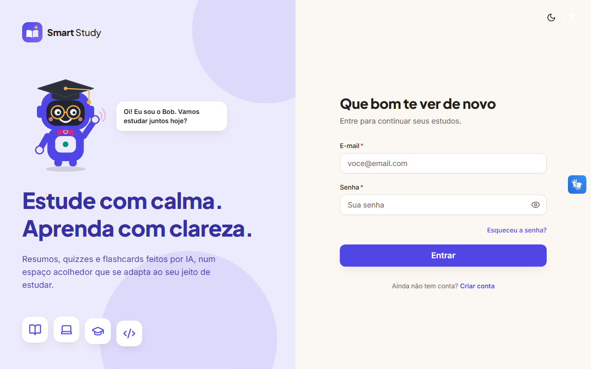

</div>

---

## Sumário

1. [Sobre o projeto](#sobre-o-projeto)
2. [Funcionalidades](#funcionalidades)
3. [Fundamentação pedagógica](#fundamentação-pedagógica)
4. [Telas](#telas)
5. [Arquitetura](#arquitetura)
6. [Como rodar](#como-rodar)
7. [Configuração (`.env`)](#configuração-env)
8. [Contas de demonstração](#contas-de-demonstração)
9. [Testes e verificações](#testes-e-verificações)
10. [API](#api)
11. [Acessibilidade e personalização](#acessibilidade-e-personalização)
12. [Privacidade e LGPD](#privacidade-e-lgpd)
13. [Deploy](#deploy)
14. [Roadmap e limitações](#roadmap-e-limitações)
15. [Autoria](#autoria)

---

## Sobre o projeto

O **Smart Study** é um assistente de estudo com inteligência artificial. O aluno organiza cadernos e aulas, pede resumos, conversa com o **Bob** (o robô-professor mascote), responde quizzes que se adaptam ao que ele mais erra, revisa com flashcards de repetição espaçada, acompanha o próprio desempenho e recebe um **plano de estudo do dia** sob medida. O professor cria turmas, envia materiais de apoio que alimentam a IA, publica tarefas e enxerga o desempenho da turma — inclusive quem precisa de atenção.

O projeto é o **Trabalho de Conclusão de Curso** de Sistemas de Informação de Carolina Lansoni Vilas Boas e tem duas partes:

- **Parte prática:** este repositório — API, site e aplicativo mobile.
- **Parte acadêmica:** relatórios e artigos sobre sistemas adaptativos, estilos de aprendizagem (ciclo de Kolb), educação por competências e ética da IA na educação. As decisões de produto aqui descritas seguem essa base teórica (veja [Fundamentação pedagógica](#fundamentação-pedagógica)).

Desenvolvido em parceria com o **Instituto Mauá de Tecnologia** e o **Grand Challenges Scholars Program (GCSP)**, com mentoria do professor Rafael Hauckewitz Todaro.

### Dois jeitos de usar

| | Aluno **avulso** | Aluno **vinculado a uma escola** |
|---|---|---|
| Como começa | Cria a conta e já estuda | Entra em uma turma com o **código** do professor (ou é matriculado por e-mail) |
| Cadernos | Os próprios | Os próprios **e** os do professor (somente leitura) |
| IA de estudo (resumo, chat, quiz, flashcards) | ✅ | ✅ |
| Tarefas e prazos do professor | — | ✅ |
| Pode sair da turma | — | ✅, quando quiser |

O **professor** não gera resumos nem quizzes de estudo: ele cria **tarefas** (quizzes) para a turma e acompanha os resultados.

---

## Funcionalidades

### 🎓 Para o aluno

- **Cadernos e aulas** com **resumo e conversa com o Bob**; quando há materiais do professor, a IA usa esse conteúdo e cita as fontes.
- **Quiz por IA, uma pergunta por tela**, com escolha de 4 a 12 perguntas e **5 tipos**: múltipla escolha, completar, dissertativa, prática e caso real. A correção acontece no servidor (o gabarito nunca vai para o aluno) e as respostas abertas são corrigidas por rubrica.
- **Reforço adaptativo:** um algoritmo de deficiências (decaimento por recência de 14 dias + suavização bayesiana) distribui as perguntas do próximo quiz e reaborda, **de outra maneira**, o que o aluno errou.
- **Flashcards** gerados por IA com **repetição espaçada (Leitner)** e gesto de deslizar (direita = lembrei, esquerda = não lembrei; botões e teclado também funcionam).
- **Agenda** com as tarefas do professor, tarefas e lembretes próprios.
- **Plano do dia:** “quanto tempo você tem hoje?” → o app cruza agenda, prazos, pontos fracos e flashcards e monta blocos de estudo, cada um com o **“por quê?”**.
- **Tempo de estudo:** contado sozinho nas telas de estudo e por um cronômetro “Estudar agora”; gráfico da semana com **meta semanal** editável.
- **Dashboard interativo** (período, matéria, detalhe por aula, alternativa em tabela): notas, acerto por tipo de pergunta, por **nível de Bloom** e por **competência**, pontos fracos e sequência de dias.
- **Perfil de aprendizagem (Kolb)** inferido do comportamento, com explicação e opção de ocultar.
- **Lembretes motivacionais** contextuais (tarefa vencendo, meta perto, sequência de dias, volta aos estudos).

### 🧑‍🏫 Para o professor

- **Turmas** com matrícula por e-mail **ou** código de entrada (regenerável).
- **Matérias e materiais de apoio** (PDF, DOCX, TXT/MD ou texto colado) usados pela IA em tarefas e estudos.
- **Tarefas:** gera perguntas com IA, **edita tudo**, marca nível de Bloom e competência, define prazo e publica. Correção no servidor, entrega única por aluno.
- **Resultados** (aba própria): visão por turma, evolução, acerto por tipo, **onde a turma mais erra**, mapa de notas aluno × aula, desempenho por Bloom e competência, **estilos de aprendizagem da turma**.
- **Atenção:** alerta de quem está **sem atividade**, com **notas em queda** ou **tarefas atrasadas** — sempre com o motivo — e atalho para criar uma **tarefa de reforço** do tópico mais difícil.

### ✨ Para todos

- **8 temas** (6 paletas + **Algodão-doce** rosa e **Programador** em modo escuro com fonte de código), claro/escuro/sistema e tamanho de texto.
- **3 idiomas:** português, inglês e espanhol, no site e no app.
- **Mascote Bob** e identidade visual própria; **acessibilidade** como requisito (contraste WCAG AA verificado por script, foco visível, leitores de tela, VLibras).

---

## Fundamentação pedagógica

As funcionalidades “adaptativas” seguem a base teórica do TCC. O que cada uma faz — e **como é explicável**:

| Conceito | No produto |
|---|---|
| **Ciclo de aprendizagem de Kolb** (experiência concreta, observação reflexiva, conceituação abstrata, experimentação ativa) | O **perfil dinâmico** mapeia o que o aluno faz a cada quadrante: casos reais → EC; resumos e conversa → OR; perguntas conceituais e flashcards → CA; perguntas práticas → EA. O estilo (Divergente, Assimilador, Convergente, Acomodador) vem de onde está a maior parte da prática. Quando um quadrante é pouco usado, o plano do dia sugere uma atividade dele (“agente de compensação”: o objetivo não é só dar o que o aluno gosta, mas completar o ciclo). |
| **Taxonomia Revisada de Bloom** | Toda pergunta tem um nível (lembrar → criar), definido pela IA ou pelo professor; os dashboards mostram o acerto por nível. |
| **Educação por competências** | O professor define competências por matéria e marca cada pergunta de tarefa; aluno e professor veem o desempenho por competência. |
| **Andaime cognitivo (scaffolding)** | O reforço adaptativo reabordando, em outro formato, o que o aluno errou; flashcards que voltam mais cedo quando esquecidos. |
| **Explicabilidade** (contra a “caixa-preta”) | Cada bloco do plano tem **“Por que isso?”**; o perfil Kolb mostra **o que foi contado**; o alerta de risco lista **os sinais**. Nada de nota ou rótulo sem justificativa. |
| **Privacidade e ética de dados** (LGPD) | Consentimento registrado, tempo de estudo **só compartilhado com autorização**, perfil ocultável, exportar e excluir os próprios dados — veja [Privacidade e LGPD](#privacidade-e-lgpd). |
| **Evasão e intervenção precoce** | O painel **Atenção** do professor e os lembretes motivacionais do aluno usam regras simples e transparentes. |
| **M-Learning** | App mobile para o aluno, com as mesmas funções de estudo, agenda e painel. |

---

## Telas

<table>
  <tr>
    <td width="50%">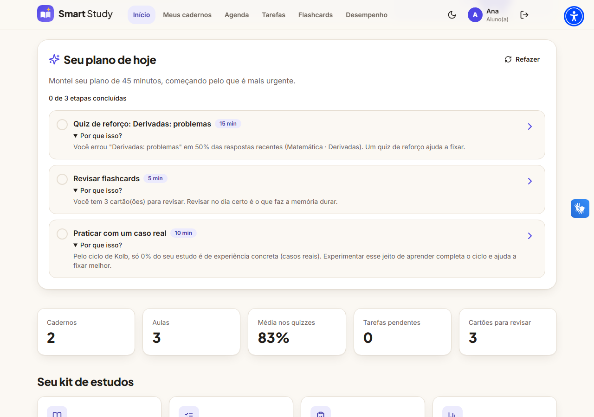<br><sub><b>Plano do dia</b> com o “por quê?” de cada sugestão</sub></td>
    <td width="50%">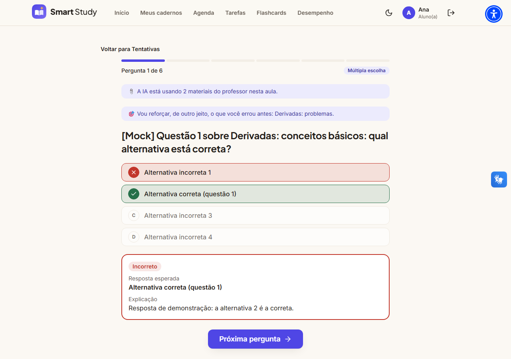<br><sub><b>Quiz</b>: uma pergunta por tela, correção na hora</sub></td>
  </tr>
  <tr>
    <td>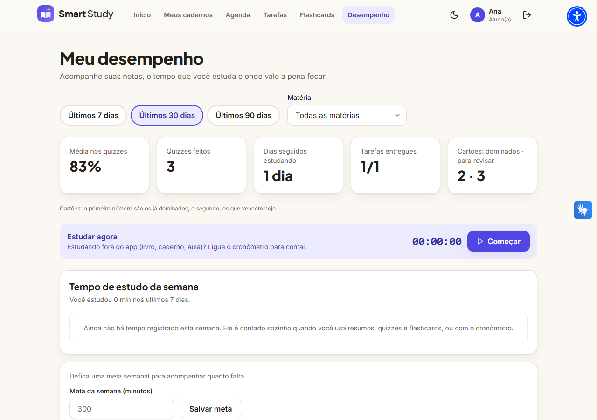<br><sub><b>Desempenho</b> do aluno: notas, tempo e meta semanal</sub></td>
    <td>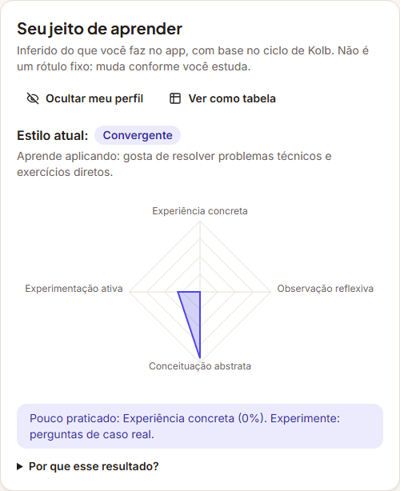<br><sub><b>Perfil de aprendizagem</b> (Kolb) com explicação</sub></td>
  </tr>
  <tr>
    <td colspan="2">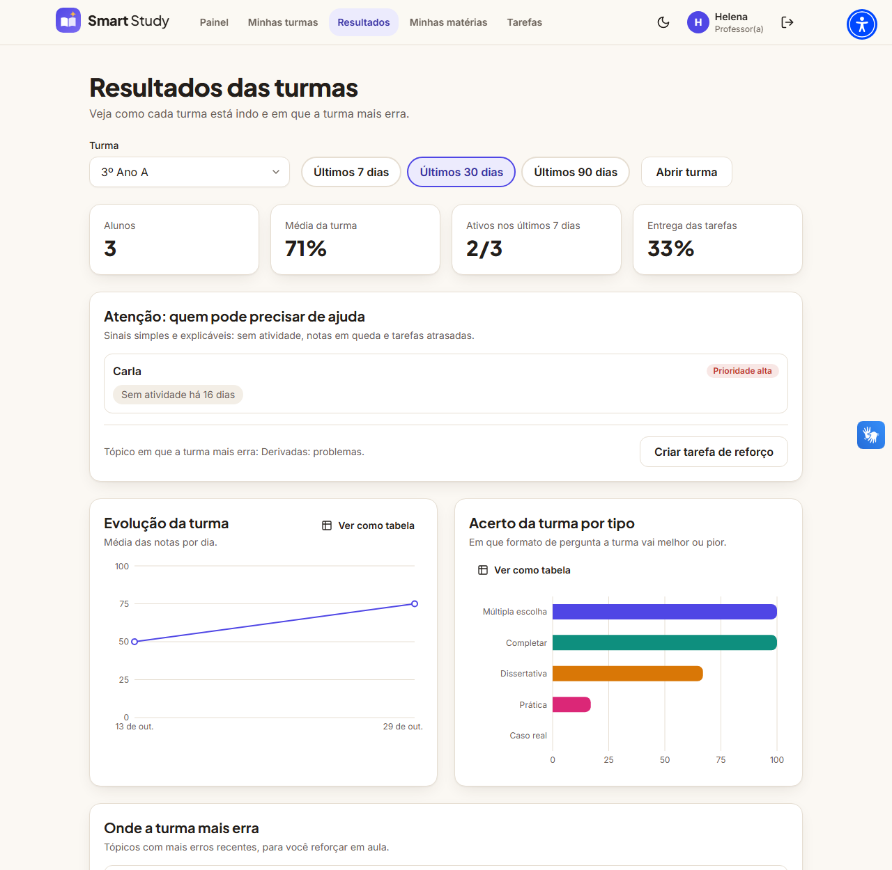<br><sub><b>Resultados do professor</b>: atenção, evolução e onde a turma mais erra</sub></td>
  </tr>
</table>

**Temas**

<table>
  <tr>
    <td width="50%">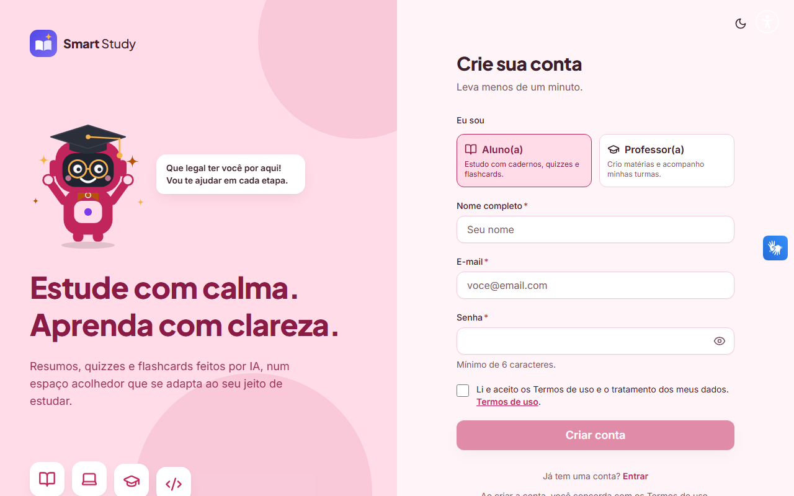<br><sub>Algodão-doce</sub></td>
    <td width="50%">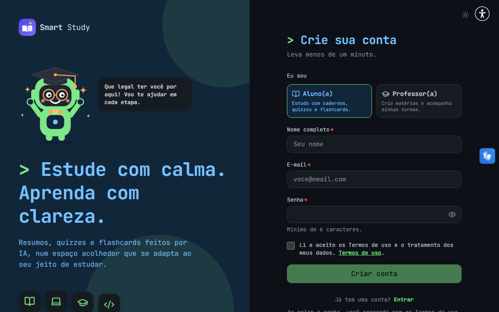<br><sub>Programador</sub></td>
  </tr>
</table>

**Aplicativo mobile**

<table>
  <tr>
    <td align="center">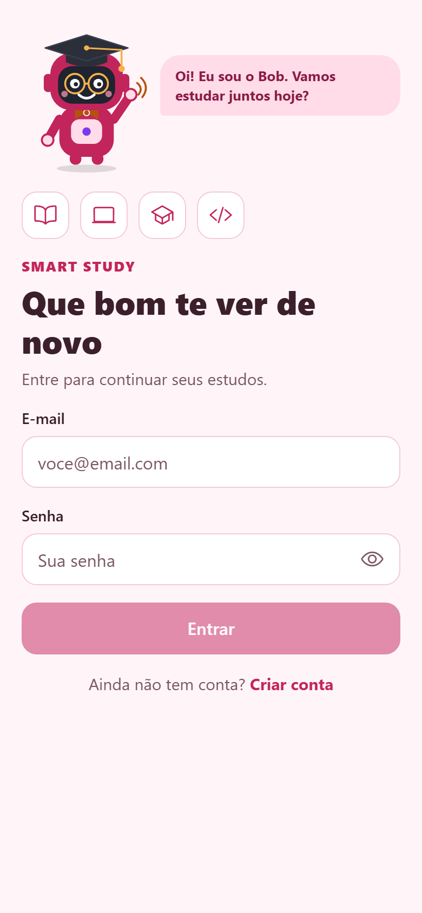</td>
    <td align="center">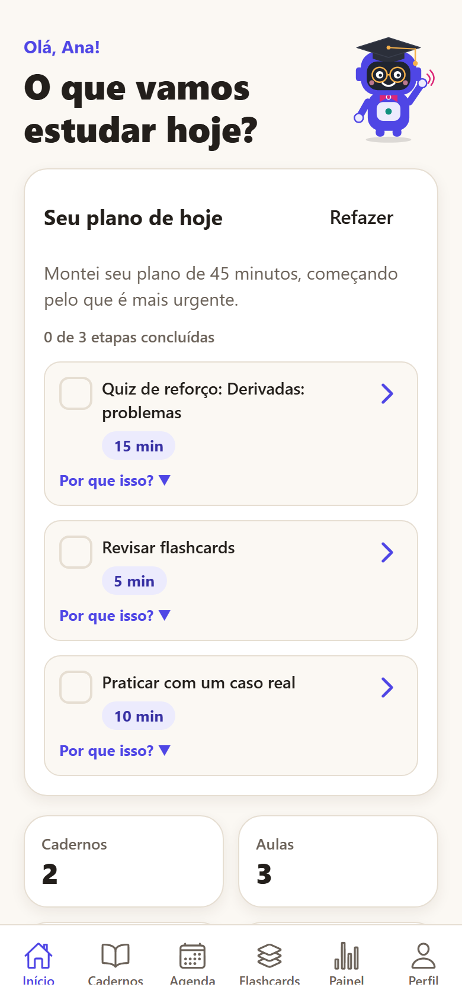</td>
    <td align="center">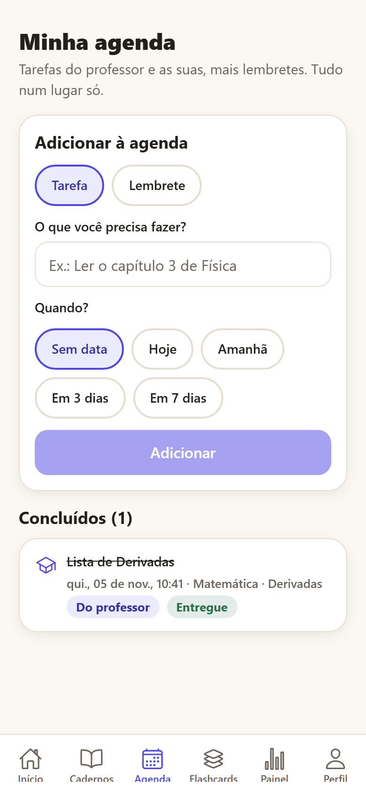</td>
    <td align="center">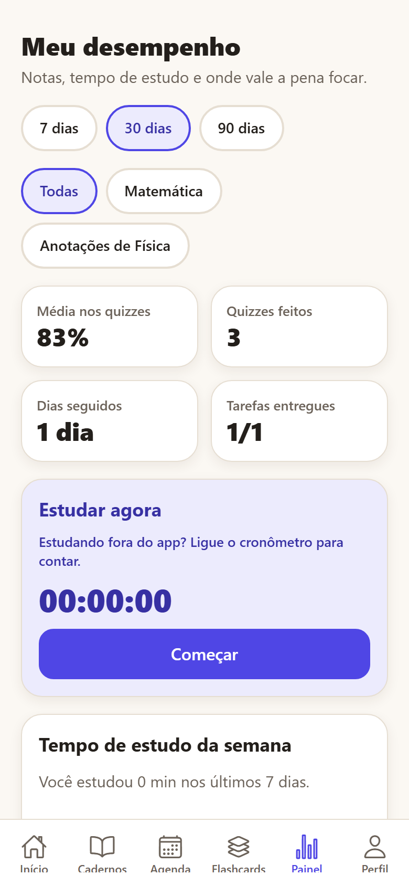</td>
  </tr>
  <tr>
    <td align="center"><sub>Entrada</sub></td><td align="center"><sub>Início</sub></td><td align="center"><sub>Agenda</sub></td><td align="center"><sub>Painel</sub></td>
  </tr>
</table>

> As capturas do app são da versão web do Expo (mesmo código), com os dados de demonstração.

---

## Arquitetura

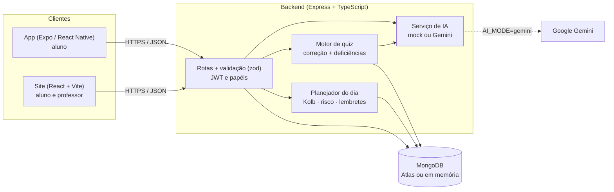

```
smart_study-back/
├── backend/    API (Express 4 · Mongoose 8 · zod · Vitest)
│   ├── src/routes/     rotas por assunto (usuario, turma, tasks, quizz, study, dashboard, results…)
│   ├── src/quiz/       tipos de pergunta, correção, algoritmo de deficiências
│   ├── src/study/      planejador do dia, Kolb, risco, lembretes, datas
│   ├── src/services/   IA (mock/Gemini), acesso a cadernos, materiais, privacidade
│   └── tests/          215 testes (API, algoritmos, privacidade)
├── frontend/   Site (React 18 · Vite · Tailwind · Radix · Recharts · i18next)
├── mobile/     App (Expo SDK 58 · Expo Router · react-native-svg)
└── docs/       imagens do README
```

Decisões de projeto que valem conhecer:

- **O servidor é a fonte da verdade.** O gabarito, a correção, as notas e as regras de acesso ficam no backend; o cliente nunca envia nota. Em **tarefas**, o aluno só vê o resultado depois de enviar tudo.
- **Acesso a cadernos centralizado** (`services/access.ts`): o dono escreve; o aluno matriculado na turma lê.
- **Papéis conferidos no banco**, não só no token (que pode ficar velho por até um dia).
- **IA com “cinto de segurança”:** respostas do Gemini são validadas com zod (uma nova tentativa se vierem inválidas); a correção de respostas abertas tem plano B por palavras-chave.
- **Identidade visual compartilhada:** as paletas e o desenho do mascote ficam em um único arquivo copiado para o app, e um script (`check:palettes`) falha se divergirem.

---

## Como rodar

### Pré-requisitos

- **Node.js 22** (ou 20+) e npm.
- Para o app: **Expo Go** no celular (celular e computador na **mesma rede Wi-Fi**).
- Nada de banco instalado: em desenvolvimento o MongoDB sobe **em memória** (na primeira execução baixa o binário do `mongod`, o que leva alguns minutos).

### Instalação

```bash
git clone <url-do-repositorio>
cd smart_study-back

npm run install:all      # raiz + backend + frontend
npm run install:mobile   # app (opcional)

cp backend/.env.example backend/.env    # no Windows: copy backend\.env.example backend\.env
```

No `backend/.env`, para ver tudo funcionando com dados de exemplo, deixe:

```env
MONGO_URI=memory
AI_MODE=mock
SEED_DEMO=true
```

### Subindo

```bash
npm run dev              # API (porta 3000) + site (http://localhost:5173)
npm run dev:mobile       # app: escaneie o QR code com o Expo Go
npm run dev:mobile:web   # ou abra o app no navegador
```

- O app descobre a API pelo **IP do computador** (porta 3000). No Windows, **libere o Node.js no firewall** quando o sistema perguntar. Para apontar para outro servidor, use `EXPO_PUBLIC_API_URL` (veja `mobile/.env.example`).
- Com `MONGO_URI=memory` os dados **somem a cada reinício**; `SEED_DEMO=true` recria os dados de demonstração sempre.

---

## Configuração (`.env`)

**Backend** (`backend/.env`, modelo em `backend/.env.example`):

| Variável | Para quê | Padrão / exemplo |
|---|---|---|
| `MONGO_URI` | `memory` (MongoDB em memória, só dev) ou a connection string do **MongoDB Atlas** | `memory` |
| `JWT_SECRET` | Segredo que assina os tokens — **use um valor longo e aleatório** | — |
| `PORT` | Porta da API | `3000` |
| `AI_MODE` | `mock` (respostas fictícias, sem chave) ou `gemini` (IA real) | `mock` |
| `GEMINI_API_KEY` | Chave do Google AI Studio (obrigatória com `AI_MODE=gemini`) | — |
| `GEMINI_MODEL` | Modelo do Gemini | `gemini-2.5-flash` |
| `CORS_ORIGIN` | Origens permitidas em produção, separadas por vírgula | vazio (em dev tudo é permitido) |
| `TEACHER_INVITE_CODE` | Código exigido no cadastro de professores (vazio = cadastro de professor desativado) | `professor-demo` |
| `SEED_DEMO` | Cria turma, usuários e dados de exemplo ao iniciar (só dev) | `false` |
| `AI_RATE_LIMIT` | Pedidos de IA por minuto e por IP | `30` |
| `JOIN_RATE_LIMIT` | Tentativas de código de turma por minuto e por IP | `15` |
| `REQUIRE_CONSENT` | `false` desliga a exigência de aceitar os Termos no cadastro (usado só nos testes automatizados) | exigido |

**Frontend:** `VITE_API_URL` (opcional; padrão `http://localhost:3000/api`).
**Mobile:** `EXPO_PUBLIC_API_URL` (opcional; padrão: IP da máquina que roda o Expo, porta 3000).

> ⚠️ **Nunca** coloque chaves (Gemini, Atlas, `JWT_SECRET`) em arquivos versionados nem em conversas. O `.gitignore` já ignora `.env`; use sempre os arquivos `.env` locais ou as variáveis do serviço de hospedagem.

### Conectando o MongoDB Atlas e o Gemini reais

1. Crie um cluster no Atlas, um usuário de banco e libere o IP de quem acessa; copie a connection string para `MONGO_URI`.
2. Gere uma chave no Google AI Studio e coloque em `GEMINI_API_KEY`; troque `AI_MODE=gemini`.
3. Reinicie o backend. O endpoint `GET /api/health` mostra o modo da IA em uso.

---

## Contas de demonstração

Com `SEED_DEMO=true`, o backend cria (senha de todas: **`demo1234`**):

| Perfil | E-mail | Observações |
|---|---|---|
| Professora | `professor@demo.com` | Helena Souza · turma “3º Ano A” e matéria “Matemática” |
| Aluna | `aluno1@demo.com` | Ana · vinculada à turma, com baralho de flashcards e tarefa entregue |
| Aluno | `aluno2@demo.com` | Bruno · vinculado, tem pontos fracos e tarefa pendente |
| Aluna | `aluno3@demo.com` | Carla · vinculada, **sem atividade há 16 dias** (aparece no painel Atenção) |
| Aluno avulso | `aluno4@demo.com` | Diego · sem turma, com um caderno próprio |

O **código da turma** aparece no log do backend ao iniciar e na página da turma (professor).
Para criar uma conta de professor pelo site, use o código de convite do `.env` (`professor-demo` por padrão).

---

## Testes e verificações

```bash
npm test                              # 215 testes do backend (Vitest + Supertest + MongoDB em memória)

cd frontend
npx tsc --noEmit                      # tipos
npm run build                         # build de produção
npm run check:contrast                # contraste WCAG AA das 8 paletas (345 verificações)

cd ../mobile
npm run typecheck                     # tipos
npm run check:palettes                # paletas e mascote idênticos aos do site
npm run check:native                  # empacota para Android e iOS (pega erros que só aparecem no celular)
```

Os testes do backend cobrem autenticação e papéis, vínculo aluno/turma, correção por tipo de pergunta, algoritmo de deficiências, Leitner, tarefas, agenda, plano do dia, Kolb, risco, lembretes, dashboards e privacidade (exportar e excluir conta).

---

## API

Todas as rotas ficam em `/api` e usam JWT (`Authorization: Bearer …`), exceto cadastro, login e `health`.

| Grupo | Rotas principais | Quem usa |
|---|---|---|
| `/usuario` | `register`, `login`, `me` (GET/PUT/DELETE), `me/export`, `me/password` | todos |
| `/turmas` | CRUD, matrícula por e-mail, `join` (código), `leave`, `mine`, novo código | professor / aluno |
| `/notebooks` · `/lessons` | cadernos e aulas; `/notebooks/:id/materials` e `/competencies` | dono / alunos da turma (leitura) |
| `/ai` | `summarize`, `chat` | aluno |
| `/quizz` | `drafts` (gera), `drafts/:id/answer`, `drafts/:id/finish`, `weakness` | aluno |
| `/tasks` | gerar, criar, publicar, entregas; `mine`, `start` | professor / aluno |
| `/flashcards` | baralhos, gerar, sessão, revisão | aluno |
| `/agenda` | tarefas e lembretes próprios + tarefas do professor | aluno |
| `/study` | `sessions`, `week`, `plan`, `nudges` | aluno |
| `/dashboard` | `student` | aluno |
| `/results` | `overview`, `turmas/:id` (+ `timeline`, `weakness`, `risk`, `learning-styles`, `outcomes`) | professor |
| `/health` | modo da IA | público |

Entradas são validadas com **zod**; chamadas de IA e tentativas de código de turma têm **limite de taxa**; o login devolve sempre a mesma mensagem de erro (não revela se o e-mail existe).

---

## Acessibilidade e personalização

- **Contraste WCAG AA** verificado por script nos 8 temas (claro e escuro quando o tema permite).
- **Teclado e leitores de tela:** foco visível, rótulos e regiões `aria-live`, gráficos com **resumo em texto** e **alternativa em tabela**, o gesto de deslizar dos flashcards sempre tem botões e atalhos equivalentes.
- **Movimento reduzido:** respeita `prefers-reduced-motion` (inclusive nas animações do Bob e na troca de perguntas).
- **Recursos de apoio:** VLibras e UserWay no site; opções de áudio e Libras na conta.
- **Temas:** Índigo, Matcha, Terracota, Oceano, Lavanda, Grafite, **Algodão-doce** e **Programador** (este só existe no modo escuro, por design — o app avisa e bloqueia o seletor).
- **Idiomas:** `pt-BR`, `es-ES` e `en-US` (preferência salva na conta).

---

## Privacidade e LGPD

- **Consentimento:** o cadastro exige aceitar os Termos de uso; o aceite e a versão ficam registrados.
- **Minimização:** o professor só vê o **tempo de estudo** de quem **permitir** (desligado por padrão); o **perfil de aprendizagem** pode ser ocultado e, oculto, não é usado em lugar nenhum.
- **Direitos do titular:** em *Minha conta → Privacidade e dados* o usuário **baixa todos os seus dados** (JSON, sem a senha) e **exclui a conta** (confirmando a senha). A exclusão apaga os dados da pessoa; para professores, também as turmas, matérias, materiais e tarefas, junto com o que os alunos produziram nelas.
- **IA de terceiros:** com `AI_MODE=gemini`, temas, mensagens e materiais são enviados ao provedor de IA para gerar as respostas — os Termos de uso informam isso.

---

## Deploy

Um caminho simples e gratuito para publicar:

**Backend (Render, *Web Service*)**

- *Root directory:* `backend`
- *Build command:* `npm install && npm run build`
- *Start command:* `npm start`
- Variáveis: `MONGO_URI` (Atlas), `JWT_SECRET`, `AI_MODE=gemini`, `GEMINI_API_KEY`, `CORS_ORIGIN` (a URL do site), `TEACHER_INVITE_CODE`. **Não** use `SEED_DEMO` em produção.

**Site (Render *Static Site*, Netlify ou Vercel)**

- *Root directory:* `frontend` · *Build:* `npm install && npm run build` · *Publish:* `dist`
- Variável: `VITE_API_URL=https://<seu-backend>/api`
- Configure o *rewrite* de todas as rotas para `index.html` (o site usa roteamento no navegador).

**App mobile**

- Defina `EXPO_PUBLIC_API_URL=https://<seu-backend>/api` e gere as builds com o **EAS** (`npx eas-cli build`). As notificações do sistema ainda não foram implementadas (veja o roadmap).

> O deploy ainda não foi automatizado; os passos acima são o roteiro previsto na Fase 9 do roadmap.

---

## Roadmap e limitações

**Já entregue:** cadernos e IA de estudo, quiz com 5 tipos e reforço adaptativo, turmas e materiais, tarefas e painel do professor, flashcards, app mobile, agenda, plano do dia, dashboards, perfil de Kolb, Bloom e competências, LGPD, alerta de risco, temas, mascote e espanhol.

**Próximos passos (Fase 9):**

- [ ] Ligar **MongoDB Atlas** e **Gemini reais** e validar a correção por rubrica com a IA de verdade.
- [ ] **Streaming** das respostas do chat (SSE) e migração para o SDK `@google/genai`.
- [ ] Cache do contexto de materiais e limites de uso por aluno.
- [ ] Deploy documentado e automatizado.
- [ ] Notificações do sistema para os lembretes da agenda (exige *development build* do Expo).
- [ ] Modo offline no app (flashcards e resumos salvos).
- [ ] Recuperação de senha por e-mail (hoje a rota responde “não implementado”).

**Limitações conhecidas**

- Com `AI_MODE=mock`, os textos de demonstração das perguntas só existem em português e inglês (em espanhol aparecem em inglês); com o Gemini ligado a IA responde no idioma do aluno.
- A correção de respostas abertas só é confiável com o Gemini real; no modo `mock` ela é aproximada (palavras-chave da rubrica).
- O perfil de Kolb é uma **inferência** a partir do comportamento no app, não um teste psicométrico: serve para orientar atividades, não para rotular pessoas — por isso é explicado e pode ser ocultado.
- O comportamento do teclado no celular só pode ser conferido em um aparelho real.

---

## Autoria

Projeto desenvolvido por **Carolina Lansoni Vilas Boas** (Sistemas de Informação, Instituto Mauá de Tecnologia), com mentoria do professor **Rafael Hauckewitz Todaro**, no âmbito do **Grand Challenges Scholars Program**.

Contato: smartstudywebsite@gmail.com

Licença: ISC (veja `backend/package.json`).
